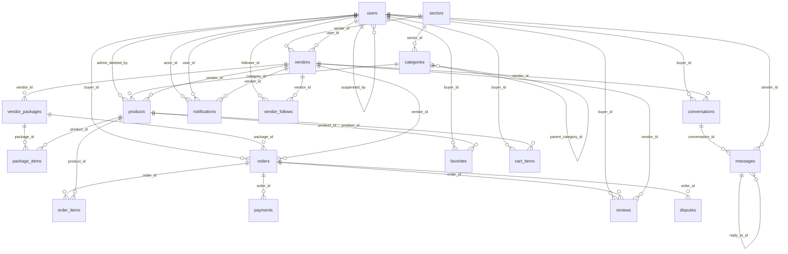

# Database tables and how they relate

Generated by `npm run schema:relationships` from the baseline export of the live database
(`medris-backend/src/database/baseline/01-public-schema.sql`) - do not edit by hand. Refresh the baseline first
(`npm run db:baseline:update -w medris-backend`) when the live schema changes.

**74 tables, 124 links** (foreign keys). "on delete cascade" means deleting the row it points at also
deletes this one; "set null" clears the link; "no action" refuses the delete while rows still point at it.

## The core, as a diagram

## Every table

### `account_appeals`

[A] Accounts, identity & security - Appeals written by suspended users; reviewed by admins.

Columns: `id`, `user_id`, `suspension_reason`, `message`, `status`, `admin_response`, `created_at`, `resolved_at`, `resolved_by`

Points at: `resolved_by` -> `users` (no action); `user_id` -> `users` (cascade)

### `admin_actions`

[A] Accounts, identity & security - Audit log of admin actions (who did what to which record).

Columns: `id`, `admin_id`, `admin_name`, `action`, `target_type`, `target_id`, `target_label`, `created_at`

Points at: `admin_id` -> `users` (no action)

### `admin_login_otps`

[A] Accounts, identity & security - One-time email codes for admin login (verified by api/auth-otp.js). Short-lived, no client access.

Columns: `id`, `user_id`, `code`, `expires_at`, `used_at`, `created_at`

Points at: `user_id` -> `users` (no action)

### `ai_conversations`

[I] Levi (AI assistant) & usage limits - Levi conversations per user (optional share token).

Columns: `id`, `user_id`, `title`, `created_at`, `updated_at`, `share_token`

Points at: `user_id` -> `users` (cascade)

Pointed at by: `ai_messages.conversation_id`

### `ai_messages`

[I] Levi (AI assistant) & usage limits - Messages in a Levi conversation, with reaction and attachment fields.

Columns: `id`, `conversation_id`, `role`, `content`, `created_at`, `reaction`, `attachment_url`, `attachment_name`, `attachment_type`, `attachment_size`

Points at: `conversation_id` -> `ai_conversations` (cascade)

### `app_presence`

[A] Accounts, identity & security - Is the app open right now heartbeat (touch_presence / clear_presence RPCs). api/notify.js skips system pushes for 45 s after the last beat so notifications stay in-app. Different purpose from user_presence.

Columns: `user_id`, `seen_at`

### `auth_activity_logs`

[A] Accounts, identity & security - Sign-in / sign-out / session events for the admin Login logs page.

Columns: `id`, `session_id`, `user_id`, `event_type`, `occurred_at`, `user_agent`, `ip`, `source`, `created_at`

Points at: `user_id` -> `auth.users` (cascade)

### `blocked_users`

[A] Accounts, identity & security - Pairs (blocker, blocked) that stop two users messaging each other.

Columns: `blocker_id`, `blocked_id`, `created_at`

Points at: `blocked_id` -> `auth.users` (cascade); `blocker_id` -> `auth.users` (cascade)

### `bookings`

[C] Catalogue, engagement & search - Date ranges reserved for rental order items (exclusion constraint prevents double booking).

Columns: `id`, `product_id`, `order_item_id`, `date_range`, `quantity`, `created_at`

Points at: `order_item_id` -> `order_items` (cascade); `product_id` -> `products` (cascade)

### `campus_submissions`

Columns: `name_norm`, `name`, `status`, `merged_into`, `submitted_by`, `requests`, `created_at`, `reviewed_at`

### `cart_items`

[D] Cart, orders & disputes - Items a buyer has in the cart (product + optional variant + quantity).

Columns: `id`, `buyer_id`, `product_id`, `quantity`, `created_at`, `variant_id`

Points at: `buyer_id` -> `users` (cascade); `product_id` -> `products` (cascade); `variant_id` -> `product_variants` (cascade)

### `categories`

[B] Vendors & storefronts - Two-level tree under a sector: parent_category_id is null for a parent ('Other'), set for sub-categories. Products point at sub-categories. A trigger gives uncategorised products a default sub-category named after the vendor's sector.

Columns: `id`, `name`, `parent_category_id`, `sector_id`

Points at: `parent_category_id` -> `categories` (set null); `sector_id` -> `sectors` (no action)

Pointed at by: `categories.parent_category_id`, `equipment_requests.category_id`, `products.category_id`

### `chat_archive`

[F] Messaging & calls - Private archive of chats removed 24 h after an order completes (kept 30 days).

Columns: `id`, `conversation_id`, `buyer_id`, `vendor_id`, `conversation`, `messages`, `archived_at`

### `chat_list_conversations`

[F] Messaging & calls - Which conversations belong to which list.

Columns: `list_id`, `conversation_id`, `added_at`

Points at: `conversation_id` -> `conversations` (cascade); `list_id` -> `chat_lists` (cascade)

### `chat_lists`

[F] Messaging & calls - User-made chat folders ('lists').

Columns: `id`, `user_id`, `name`, `created_at`

Points at: `user_id` -> `users` (cascade)

Pointed at by: `chat_list_conversations.list_id`

### `chat_usage`

[I] Levi (AI assistant) & usage limits - Messages sent to Levi per user per day (limit enforced by increment_chat_usage).

Columns: `user_id`, `day`, `count`

Points at: `user_id` -> `users` (no action)

### `comment_reports`

Columns: `id`, `kind`, `comment_id`, `reporter_id`, `reason`, `created_at`

### `commission_charges`

[E] Commission & vendor billing - Commission owed per completed order.

Columns: `id`, `vendor_id`, `payment_id`, `order_id`, `amount`, `status`, `created_at`, `paid_at`, `due_at`

Points at: `order_id` -> `orders` (set null); `payment_id` -> `payments` (set null); `vendor_id` -> `vendors` (cascade)

### `commission_deadline_reminders`

[E] Commission & vendor billing - De-duplication log so each deadline reminder is sent once.

Columns: `id`, `vendor_id`, `reminder_code`, `period_key`, `created_at`

Points at: `vendor_id` -> `vendors` (cascade)

### `commission_settlements`

[E] Commission & vendor billing - Payments a vendor makes to settle commission.

Columns: `id`, `vendor_id`, `amount`, `status`, `provider_reference`, `created_at`, `paid_at`

Points at: `vendor_id` -> `vendors` (cascade)

### `conversations`

[F] Messaging & calls - A buyer-vendor thread with pin/unread flags per side.

Columns: `id`, `buyer_id`, `vendor_id`, `created_at`, `pinned_by_buyer`, `pinned_by_vendor`, `marked_unread_by_buyer`, `marked_unread_by_vendor`

Points at: `buyer_id` -> `users` (no action); `vendor_id` -> `vendors` (no action)

Pointed at by: `chat_list_conversations.conversation_id`, `message_pins.conversation_id`, `messages.conversation_id`, `voice_calls.conversation_id`

### `disputes`

[D] Cart, orders & disputes - Issues raised on an order by a buyer or vendor; admin resolves.

Columns: `id`, `order_id`, `raised_by`, `reason`, `status`, `admin_notes`, `created_at`, `vendor_response`, `attachments`

Points at: `order_id` -> `orders` (cascade)

### `equipment_requests`

[D] Cart, orders & disputes - 'Request an item' posts from customers (also called customer requests).

Columns: `id`, `buyer_id`, `title`, `description`, `category_id`, `city`, `needed_from`, `needed_to`, `status`, `created_at`, `request_type`, `buyer_name`, `buyer_avatar_url`, `photos`, `campus_id`

Points at: `buyer_id` -> `users` (cascade); `category_id` -> `categories` (no action)

Pointed at by: `request_offers.request_id`

### `favorites`

[C] Catalogue, engagement & search - Customer wishlist (products).

Columns: `id`, `buyer_id`, `product_id`, `created_at`

Points at: `buyer_id` -> `users` (cascade); `product_id` -> `products` (cascade)

### `homepage_carousel_slides`

[J] Site content & support - Home-page banner slides (image in storage bucket homepage-carousel).

Columns: `id`, `storage_path`, `image_url`, `link_url`, `alt_text`, `sort_order`, `is_active`, `created_by`, `created_at`, `updated_at`

Points at: `created_by` -> `users` (set null)

### `inventory`

[C] Catalogue, engagement & search - Legacy healthcare-equipment / blood-stock listings from the first version of the app. Not used by the marketplace flows; candidate for removal.

Columns: `id`, `type`, `category`, `item_name`, `blood_group`, `quantity`, `urgency`, `hospital_name`, `phone`, `lat`, `lng`, `description`, `verified`, `created_at`, `owner_id`

Points at: `owner_id` -> `auth.users` (no action)

### `listing_billing_reminders`

[E] Commission & vendor billing - De-duplication log for listing-billing reminders.

Columns: `kind`, `listing_id`, `reminder_code`, `period_key`, `sent_at`

### `listing_drafts`

[E] Commission & vendor billing - Unfinished listings saved while a vendor pays.

Columns: `id`, `vendor_id`, `kind`, `draft_data`, `created_at`, `updated_at`

Points at: `vendor_id` -> `vendors` (cascade)

### `listing_payment_intents`

[E] Commission & vendor billing - Paystack payment intents for listing activation.

Columns: `id`, `reference`, `user_id`, `vendor_id`, `kind`, `amount_naira`, `status`, `listing_id`, `created_at`, `paid_at`, `consumed_at`, `draft_data`

Points at: `user_id` -> `auth.users` (cascade); `vendor_id` -> `vendors` (cascade)

### `message_pins`

[F] Messaging & calls - Pinned messages with expiry.

Columns: `id`, `user_id`, `conversation_id`, `message_id`, `pinned_at`, `expires_at`

Points at: `conversation_id` -> `conversations` (cascade); `message_id` -> `messages` (cascade); `user_id` -> `auth.users` (cascade)

### `messages`

[F] Messaging & calls - Chat messages (text, attachments, reactions, replies, edit/delete flags). Immutable for evidence: edits are limited by trigger.

Columns: `id`, `conversation_id`, `sender_id`, `body`, `created_at`, `read_at`, `delivered_at`, `reactions`, `attachment_url`, `attachment_name`, `attachment_type`, `attachment_size`, `edited_at`, `deleted_at`, `reply_to_id`

Points at: `conversation_id` -> `conversations` (cascade); `reply_to_id` -> `messages` (set null); `sender_id` -> `users` (no action)

Pointed at by: `message_pins.message_id`, `messages.reply_to_id`

### `monthly_listing_submissions`

[E] Commission & vendor billing - Receipts a vendor uploads to activate a monthly listing; admin approves or rejects.

Columns: `id`, `kind`, `listing_id`, `vendor_id`, `user_id`, `payer_name`, `receipt_path`, `status`, `submitted_at`, `reviewed_at`, `reviewed_by`, `review_note`, `created_at`, `updated_at`

Points at: `reviewed_by` -> `auth.users` (no action); `user_id` -> `auth.users` (cascade); `vendor_id` -> `vendors` (cascade)

### `notifications`

[G] Notifications - In-app notifications (type, title, body, target_view + target_params for deep links, read/archived/deleted flags). Largest table; types include new_message, order_status_changed, vendor_follow_update, incoming_call, points, rank_change.

Columns: `id`, `user_id`, `type`, `title`, `body`, `target_view`, `target_params`, `actor_id`, `actor_name`, `actor_avatar_url`, `read`, `created_at`, `archived`, `deleted_at`, `vendor_id`, `notification_category`, `group_key`, `metadata`

Points at: `actor_id` -> `users` (set null); `user_id` -> `users` (cascade); `vendor_id` -> `vendors` (set null)

### `order_items`

[D] Cart, orders & disputes - Line items of an order with the unit price at purchase time.

Columns: `id`, `order_id`, `product_id`, `quantity`, `unit_price`, `rental_start_date`, `rental_end_date`, `created_at`, `variant_id`

Points at: `order_id` -> `orders` (cascade); `product_id` -> `products` (no action); `variant_id` -> `product_variants` (set null)

Pointed at by: `bookings.order_item_id`

### `order_notes`

[D] Cart, orders & disputes - Free-text notes exchanged on an order.

Columns: `id`, `order_id`, `sender_id`, `body`, `created_at`

Points at: `order_id` -> `orders` (cascade); `sender_id` -> `users` (cascade)

### `orders`

[D] Cart, orders & disputes - One order per vendor. Money fields, delivery fields, payment_timing / payment_deposit_percent, status timestamps, payout fields (legacy card flow), awaiting_confirmation_since (24 h auto-complete timer).

Columns: `id`, `buyer_id`, `vendor_id`, `order_type`, `status`, `total_amount`, `deposit_amount`, `delivery_method`, `delivery_address`, `created_at`, `delivery_phone`, `delivery_fee`, `package_id`, `payout_status`, `auto_release_at`, `payout_released_at`, `payout_transfer_code`, `awaiting_confirmation_since`, `last_reminder_sent_at`, `buyer_note`, `status_changed_at`, `completed_at`, `cancelled_at`, `auto_completed_at`, `payment_timing`, `payment_deposit_percent`, `buyer_lat`, `buyer_lng`, `service_offer_id`, `commission_exempt`, `payment_unresolved_at`, `payment_escalated_at`, `cancellation_reason`, `quantity_proposal`

Points at: `buyer_id` -> `users` (no action); `package_id` -> `vendor_packages` (no action); `service_offer_id` -> `service_offers` (set null); `vendor_id` -> `vendors` (no action)

Pointed at by: `commission_charges.order_id`, `disputes.order_id`, `order_items.order_id`, `order_notes.order_id`, `payments.order_id`, `reviews.order_id`, `service_offers.order_id`

### `package_comment_likes`

[C] Catalogue, engagement & search - Likes on package comments.

Columns: `id`, `comment_id`, `user_id`, `created_at`

Points at: `comment_id` -> `package_comments` (cascade); `user_id` -> `users` (cascade)

### `package_comments`

[C] Catalogue, engagement & search - Comments and replies on packages.

Columns: `id`, `package_id`, `user_id`, `parent_comment_id`, `content`, `author_name`, `author_avatar_url`, `created_at`, `updated_at`

Points at: `package_id` -> `vendor_packages` (cascade); `parent_comment_id` -> `package_comments` (cascade); `user_id` -> `users` (cascade)

Pointed at by: `package_comment_likes.comment_id`, `package_comments.parent_comment_id`

### `package_engagement_settings`

[C] Catalogue, engagement & search - Vendor controls per package (same options as products).

Columns: `package_id`, `vendor_id`, `like_visibility`, `allow_comments`, `comment_audience`, `created_at`, `updated_at`

Points at: `package_id` -> `vendor_packages` (cascade); `vendor_id` -> `vendors` (cascade)

### `package_favorites`

[C] Catalogue, engagement & search - Customer wishlist (packages).

Columns: `id`, `buyer_id`, `package_id`, `created_at`

Points at: `buyer_id` -> `auth.users` (cascade); `package_id` -> `vendor_packages` (cascade)

### `package_items`

[C] Catalogue, engagement & search - Which products (and quantities) make up a package.

Columns: `id`, `package_id`, `product_id`, `quantity`, `created_at`

Points at: `package_id` -> `vendor_packages` (cascade); `product_id` -> `products` (cascade)

### `password_reset_requests`

[A] Accounts, identity & security - Manual password-reset requests approved by admins when email reset is not possible. Token is stored hashed.

Columns: `id`, `email`, `user_id`, `status`, `token_hash`, `created_at`, `approved_at`, `approved_by`, `rejected_at`, `rejected_by`, `completed_at`, `expires_at`

Points at: `approved_by` -> `auth.users` (set null); `rejected_by` -> `auth.users` (set null); `user_id` -> `auth.users` (set null)

### `payments`

[D] Cart, orders & disputes - Payment records per order: sale_price, rental_fee, deposit, delivery_deposit_20 (the pay-after deposit). status pending > paid. provider_reference tells how it was confirmed (buyer_report, vendor_confirmed, admin_confirmed, ...).

Columns: `id`, `order_id`, `payment_type`, `amount`, `method`, `status`, `provider_reference`, `created_at`, `paid_at`

Points at: `order_id` -> `orders` (cascade)

Pointed at by: `commission_charges.payment_id`

### `points_ledger`

[H] Points, leaderboard & referrals - Every award (event_key makes awards idempotent).

Columns: `id`, `user_id`, `kind`, `points`, `event_key`, `source_user_id`, `note`, `meta`, `week_start`, `created_at`

Points at: `user_id` -> `users` (cascade)

### `points_rules`

[H] Points, leaderboard & referrals - Configurable rules: kind, points, audience, daily/weekly caps.

Columns: `kind`, `label`, `description`, `points`, `audience`, `category`, `icon`, `daily_cap`, `weekly_cap`, `sort_order`, `active`, `min_amount`, `per_source_weekly_cap`

### `points_skips`

[H] Points, leaderboard & referrals - Why an award was skipped (cap reached, duplicate, ...).

Columns: `id`, `user_id`, `kind`, `ref`, `reason`, `created_at`

Points at: `user_id` -> `users` (cascade)

### `points_weekly`

[H] Points, leaderboard & referrals - Rolled-up weekly totals (also used for rank-change notifications).

Columns: `user_id`, `week_start`, `points`, `tx_count`, `last_at`, `updated_at`

Points at: `user_id` -> `users` (cascade)

### `product_comment_likes`

[C] Catalogue, engagement & search - Likes on product comments.

Columns: `id`, `comment_id`, `user_id`, `created_at`

Points at: `comment_id` -> `product_comments` (cascade); `user_id` -> `users` (cascade)

### `product_comments`

[C] Catalogue, engagement & search - Comments and replies on products.

Columns: `id`, `product_id`, `user_id`, `parent_comment_id`, `content`, `author_name`, `author_avatar_url`, `created_at`, `updated_at`

Points at: `parent_comment_id` -> `product_comments` (cascade); `product_id` -> `products` (cascade); `user_id` -> `users` (cascade)

Pointed at by: `product_comment_likes.comment_id`, `product_comments.parent_comment_id`

### `product_engagement_settings`

[C] Catalogue, engagement & search - Vendor controls per product: allow comments, who may comment, like visibility.

Columns: `product_id`, `vendor_id`, `like_visibility`, `allow_comments`, `comment_audience`, `created_at`, `updated_at`

Points at: `product_id` -> `products` (cascade); `vendor_id` -> `vendors` (cascade)

### `product_variants`

[C] Catalogue, engagement & search - Varieties of a product (own name, photo, price, size, colour, stock).

Columns: `id`, `product_id`, `name`, `photo_url`, `sale_price`, `discount_price`, `rental_rate`, `sort_order`, `created_at`, `updated_at`, `quantity_available`, `size`, `color`, `description`, `quantity_total`

Points at: `product_id` -> `products` (cascade)

Pointed at by: `cart_items.variant_id`, `order_items.variant_id`

### `products`

[C] Catalogue, engagement & search - Sellable items. is_service marks services (commission/negotiated); listing_type = sale / rent / both; billing_* columns track monthly-listing payment; payment_timing = pay_before / pay_after with payment_deposit_percent.

Columns: `id`, `vendor_id`, `category_id`, `name`, `description`, `photos`, `condition`, `listing_type`, `sale_price`, `rental_rate`, `rental_rate_unit`, `deposit_amount`, `quantity_total`, `quantity_available`, `status`, `created_at`, `view_count`, `is_service`, `service_price_unit`, `discount_price`, `delivery_fee_mode`, `delivery_fee`, `delivery_fee_per_km`, `billing_model`, `billing_status`, `billing_paid_until`, `billing_reference`, `payment_timing`, `payment_deposit_percent`, `admin_deleted_at`, `admin_deleted_by`, `track_quantity`

Points at: `admin_deleted_by` -> `users` (no action); `category_id` -> `categories` (set null); `vendor_id` -> `vendors` (cascade)

Pointed at by: `bookings.product_id`, `cart_items.product_id`, `favorites.product_id`, `order_items.product_id`, `package_items.product_id`, `product_comments.product_id`, `product_engagement_settings.product_id`, `product_variants.product_id`, `service_offers.listing_id`

### `push_subscriptions`

[A] Accounts, identity & security - Web-push endpoints per user and device (endpoint, p256dh, auth_key). Used by api/notify.js.

Columns: `id`, `user_id`, `endpoint`, `p256dh`, `auth_key`, `created_at`

Points at: `user_id` -> `auth.users` (cascade)

### `referrals`

[H] Points, leaderboard & referrals - Who referred whom (referral codes live on vendors.referral_code).

Columns: `referred_user_id`, `referrer_user_id`, `referrer_vendor_id`, `code`, `created_at`, `vendor_awarded`

Points at: `referred_user_id` -> `users` (cascade); `referrer_user_id` -> `users` (cascade); `referrer_vendor_id` -> `vendors` (cascade)

### `request_offers`

[D] Cart, orders & disputes - Vendor offers made on a customer request.

Columns: `id`, `request_id`, `vendor_id`, `message`, `price`, `status`, `created_at`

Points at: `request_id` -> `equipment_requests` (cascade); `vendor_id` -> `vendors` (cascade)

### `reviews`

[C] Catalogue, engagement & search - Star rating + comment left by a buyer after a completed order. Triggers keep vendors.avg_rating / review_count current.

Columns: `id`, `order_id`, `buyer_id`, `vendor_id`, `rating`, `comment`, `created_at`, `buyer_name`, `buyer_avatar_url`

Points at: `buyer_id` -> `users` (no action); `order_id` -> `orders` (cascade); `vendor_id` -> `vendors` (no action)

### `search_synonyms`

[C] Catalogue, engagement & search - Synonym pairs used by search_products_full_v2 / search_product_ids.

Columns: `term`, `synonym`

### `sectors`

[B] Vendors & storefronts - Top-level business sectors (e.g. Fashion & Beauty). Vendors can create custom sectors.

Columns: `id`, `slug`, `name`, `icon`, `sort_order`

Pointed at by: `categories.sector_id`, `vendors.sector_id`

### `service_offers`

[D] Cart, orders & disputes - Negotiation thread for a service listing (price rounds, accept, payment reported, completed). Creates an order when accepted.

Columns: `id`, `listing_id`, `buyer_id`, `vendor_id`, `description`, `current_price`, `current_offer_by`, `status`, `round_count`, `created_at`, `updated_at`, `expires_at`, `accepted_at`, `payment_reported_at`, `completed_at`, `order_id`, `payment_reminder_sent_at`, `vendor_confirmation_reminder_sent_at`

Points at: `buyer_id` -> `users` (cascade); `listing_id` -> `products` (cascade); `order_id` -> `orders` (set null); `vendor_id` -> `vendors` (cascade)

Pointed at by: `orders.service_offer_id`

### `suggestions`

[J] Site content & support - Feedback / suggestions sent by users (optionally anonymous) to admins or a vendor.

Columns: `id`, `sender_id`, `target_type`, `target_vendor_id`, `message`, `is_anonymous`, `status`, `created_at`

Points at: `sender_id` -> `auth.users` (set null); `target_vendor_id` -> `vendors` (cascade)

### `support_requests`

[J] Site content & support - Support tickets with admin reply and attachments.

Columns: `id`, `user_id`, `subject`, `message`, `status`, `admin_reply`, `created_at`, `updated_at`, `attachments`

Points at: `user_id` -> `auth.users` (cascade)

### `tts_usage`

[I] Levi (AI assistant) & usage limits - Text-to-speech characters used per user per day.

Columns: `user_id`, `day`, `chars`

Points at: `user_id` -> `auth.users` (cascade)

### `user_presence`

[A] Accounts, identity & security - Last-seen timestamp per user (touch_last_seen RPC, every ~45 s). Drives last seen in chats.

Columns: `user_id`, `last_seen_at`

Points at: `user_id` -> `users` (cascade)

### `users`

[A] Accounts, identity & security - Application profile for every account (buyer, vendor, admin). Same id as auth.users. Holds role, contact info, suspension state, legal-terms acceptance, super-admin flag.

Columns: `id`, `name`, `phone`, `email`, `role`, `city`, `created_at`, `avatar_url`, `address`, `ai_data_consent`, `role_selected`, `suspended_at`, `suspended_reason`, `suspended_by`, `is_super_admin`, `has_password`, `otp_verified_at`, `legal_terms_version`, `legal_terms_accepted_at`, `campus_id`

Points at: `id` -> `auth.users` (cascade); `suspended_by` -> `users` (no action)

Pointed at by: `account_appeals.resolved_by`, `account_appeals.user_id`, `admin_actions.admin_id`, `admin_login_otps.user_id`, `ai_conversations.user_id`, `cart_items.buyer_id`, `chat_lists.user_id`, `chat_usage.user_id`, `conversations.buyer_id`, `equipment_requests.buyer_id`, `favorites.buyer_id`, `homepage_carousel_slides.created_by`, `messages.sender_id`, `notifications.actor_id`, `notifications.user_id`, `order_notes.sender_id`, `orders.buyer_id`, `package_comment_likes.user_id`, `package_comments.user_id`, `points_ledger.user_id`, `points_skips.user_id`, `points_weekly.user_id`, `product_comment_likes.user_id`, `product_comments.user_id`, `products.admin_deleted_by`, `referrals.referred_user_id`, `referrals.referrer_user_id`, `reviews.buyer_id`, `service_offers.buyer_id`, `user_presence.user_id`, `users.suspended_by`, `vendor_follow_preferences.follower_id`, `vendor_follows.follower_id`, `vendor_recycle_bin.deleted_by`, `vendor_week_winners.user_id`, `vendors.user_id`, `voice_calls.callee_id`, `voice_calls.caller_id`

### `vendor_follow_preferences`

[B] Vendors & storefronts - Per-follow notification preferences (new listing, price change, discount, mute window).

Columns: `id`, `follower_id`, `vendor_id`, `muted_until`, `mute_mode`, `notify_new_listing`, `notify_new_service`, `notify_new_package`, `notify_new_variety`, `notify_price_change`, `notify_discount`, `created_at`, `updated_at`

Points at: `follower_id` -> `users` (cascade); `vendor_id` -> `vendors` (cascade)

### `vendor_follows`

[B] Vendors & storefronts - Customer follows vendor.

Columns: `id`, `follower_id`, `vendor_id`, `created_at`

Points at: `follower_id` -> `users` (cascade); `vendor_id` -> `vendors` (cascade)

### `vendor_monthly_charges`

[E] Commission & vendor billing - Monthly billing runs per vendor.

Columns: `id`, `vendor_id`, `listing_count`, `amount`, `status`, `provider_reference`, `failure_reason`, `created_at`

Points at: `vendor_id` -> `vendors` (no action)

### `vendor_packages`

[C] Catalogue, engagement & search - Bundles of products sold at one price.

Columns: `id`, `vendor_id`, `name`, `description`, `price`, `status`, `created_at`, `photos`, `billing_model`, `billing_status`, `billing_paid_until`, `billing_reference`

Points at: `vendor_id` -> `vendors` (cascade)

Pointed at by: `orders.package_id`, `package_comments.package_id`, `package_engagement_settings.package_id`, `package_favorites.package_id`, `package_items.package_id`

### `vendor_profile_view_events`

[B] Vendors & storefronts - One row per storefront view; powers 'Views today' and analytics.

Columns: `id`, `vendor_id`, `viewed_at`

Points at: `vendor_id` -> `vendors` (cascade)

### `vendor_recycle_bin`

[B] Vendors & storefronts - Snapshot taken when an admin trashes a vendor so it can be restored exactly.

Columns: `vendor_id`, `deleted_at`, `deleted_by`, `product_statuses`, `package_statuses`, `created_at`

Points at: `deleted_by` -> `users` (set null); `vendor_id` -> `vendors` (cascade)

### `vendor_student_verification`

Columns: `vendor_id`, `matric_number`, `faculty`, `department`, `level`, `id_card_url`, `biodata_url`, `status`, `review_note`, `reviewed_by`, `reviewed_at`, `created_at`, `updated_at`, `selfie_url`, `face_distance`, `face_match`, `face_liveness`, `face_checked_at`, `ocr_matric_found`, `ocr_name_found`, `ocr_text`, `ocr_checked_at`, `face_v`, `matric_pending`

Points at: `vendor_id` -> `vendors` (cascade)

### `vendor_week_winners`

[H] Points, leaderboard & referrals - Snapshot of each finished week's winners.

Columns: `week_start`, `user_id`, `vendor_id`, `points`, `tx_count`, `top3`, `reward_status`, `finalized_at`

Points at: `user_id` -> `users` (cascade); `vendor_id` -> `vendors` (cascade)

### `vendors`

[B] Vendors & storefronts - One row per shop: business details, verification status, bank/Paystack codes, commission and monthly-billing state, delivery settings, location, ratings, soft-delete fields.

Columns: `id`, `user_id`, `business_name`, `logo_url`, `cover_image_url`, `bio`, `address`, `city`, `phone`, `whatsapp_number`, `verification_status`, `cac_number`, `verification_docs`, `delivery_radius_km`, `opening_hours`, `avg_rating`, `created_at`, `is_active`, `bank_code`, `bank_name`, `account_number`, `account_name`, `paystack_subaccount_code`, `commission_pct`, `delivery_fee`, `sector_id`, `deleted_at`, `transfer_recipient_code`, `billing_model`, `paystack_authorization_code`, `paystack_customer_code`, `monthly_billing_status`, `next_monthly_charge_at`, `review_count`, `lat`, `lng`, `business_hours`, `allow_after_hours_messages`, `delivery_fee_mode`, `delivery_fee_per_km`, `previous_business_name`, `name_changed_at`, `whatsapp_visible`, `cover_url`, `commission_paused`, `commission_pause_reason`, `deleted_previous_verification_status`, `deleted_previous_is_active`, `admin_paused`, `profile_view_count`, `referral_code`, `campus_id`, `request_pref`, `operating_scope`, `operating_campuses`, `request_campus_scope`, `student_verified`, `campus_setup_done`

Points at: `sector_id` -> `sectors` (no action); `user_id` -> `users` (cascade)

Pointed at by: `commission_charges.vendor_id`, `commission_deadline_reminders.vendor_id`, `commission_settlements.vendor_id`, `conversations.vendor_id`, `listing_drafts.vendor_id`, `listing_payment_intents.vendor_id`, `monthly_listing_submissions.vendor_id`, `notifications.vendor_id`, `orders.vendor_id`, `package_engagement_settings.vendor_id`, `product_engagement_settings.vendor_id`, `products.vendor_id`, `referrals.referrer_vendor_id`, `request_offers.vendor_id`, `reviews.vendor_id`, `service_offers.vendor_id`, `suggestions.target_vendor_id`, `vendor_follow_preferences.vendor_id`, `vendor_follows.vendor_id`, `vendor_monthly_charges.vendor_id`, `vendor_packages.vendor_id`, `vendor_profile_view_events.vendor_id`, `vendor_recycle_bin.vendor_id`, `vendor_student_verification.vendor_id`, `vendor_week_winners.vendor_id`

### `voice_calls`

[F] Messaging & calls - Call log and state (ringing > active > ended / declined / missed) plus ring counter.

Columns: `id`, `conversation_id`, `caller_id`, `callee_id`, `status`, `created_at`, `answered_at`, `ended_at`, `rings`

Points at: `callee_id` -> `users` (cascade); `caller_id` -> `users` (cascade); `conversation_id` -> `conversations` (cascade)

